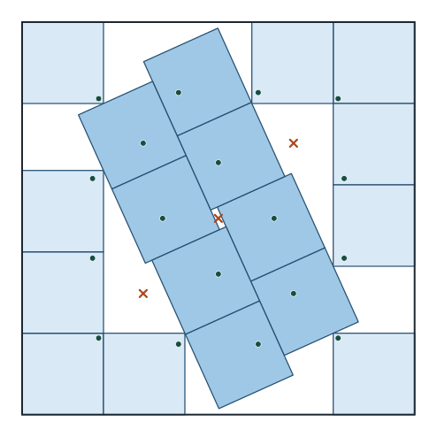

# Lean Conjecture Lab

Proofs and counterexamples to published mathematical questions. Each entry links to the original statement, explains the argument, and identifies what Lean checked.

## Results

| No. | Question | Result | Lean |
| ---: | --- | --- | --- |
| 1 | [OEIS A250346](https://oeis.org/A250346) · Arrays with bounded entries and multiplicity | [Proof of Hardin’s recurrence for every length and Barker’s generating function](results/oeis-a250346/) | ✅ [Recurrence](ConjectureLab/ShiftedArrays.lean) · [Generating function](ConjectureLab/ShiftedArraysSeries.lean) |
| 2 | [Packing eighteen unit squares](#packing-eighteen-unit-squares) | Minimum container side $(7+\sqrt{7})/2$ · [Independent verification](research/pack-18-squares/follow-up/endpoint.md) | [Supporting lemmas](ConjectureLab/PackingEndpoint.lean) |

✅ means Lean checked the full statement in the result column. The full packing verification uses C++ and Python. The linked reports credit the original authors and document the checks.

## Packing eighteen unit squares

**We independently confirmed Mira Cult's optimality result for Hämäläinen's 1980 packing.** The smallest square that holds eighteen unit squares has side $(7+\sqrt7)/2 \approx 4.822875655532295$. Each tile can move and rotate freely, and tiles may touch. The construction below attains the minimum. [Historical construction](https://erich-friedman.github.io/papers/squares/squares.html#figure7) · [Mira Cult's 2026 proof](https://github.com/Mira-Cult/math/tree/78bec6aacebf304d942a9225e16c2f18165778ff/notes/geometry/unit-square-packing-18)



The dots and crosses explain how the proof covers every arrangement. Each tile can be assigned a distinct point from the same set of 21. The three unused points, shown as crosses here, determine one of 187 cases up to rotation and reflection.

We used Mira Cult’s points, division into cases and geometric argument. Our C++ and Python programs independently recomputed the possible positions and orientations of the tiles. They excluded 181 cases outright and checked all 193 regions of the other six. Together those checks rule out every smaller container. Lean verifies the supporting chord and separating-line inequalities. [Proof and scope](research/pack-18-squares/follow-up/endpoint.md) · [Verification output](research/pack-18-squares/follow-up/endpoint-replay.txt) · [Lean lemmas](ConjectureLab/PackingEndpoint.lean)

To replay the packing result from the repository root with Python 3.10 or later and a C++17 compiler, run

```sh
python3 research/pack-18-squares/follow-up/verify_endpoint.py --workers 3
```

## Verify the OEIS result

From a clone with [Elan](https://lean-lang.org/install/) and Python 3 installed, run the following commands. The repository pins Lean and Mathlib to version 4.36.0.

```sh
lake exe cache get Mathlib.Algebra.BigOperators.Fin Mathlib.Data.Fintype.BigOperators Mathlib.Tactic.FinCases Mathlib.RingTheory.PowerSeries.Basic Mathlib.Tactic.Ring Mathlib.Analysis.SpecialFunctions.Trigonometric.Bounds Mathlib.Tactic.FieldSimp Mathlib.Tactic.LinearCombination
lake build
lake env lean results/oeis-a250346/Audit.lean
lake env leanchecker ConjectureLab.ShiftedArrays
lake env leanchecker ConjectureLab.ShiftedArraysSeries
python3 results/oeis-a250346/verify.py
```

The Python check runs offline. To compare against the 210 published values, download the [OEIS table](https://oeis.org/A250346/b250346.txt) and pass its path to the script with `--b-file`.
