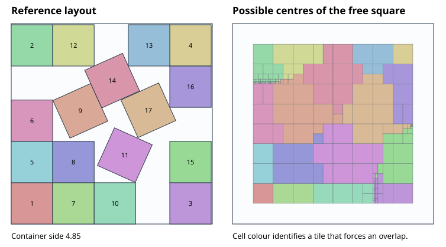

# Inserting a free eighteenth square

The earlier SAT search constrained every tile to a prescribed finite list of poses. Here the eighteenth tile can take **any real centre and orientation**. The restrictions are on the other seventeen tiles. These results exclude families of placements and leave the unrestricted packing problem open.

## A Lean-checked exclusion for a continuous neighbourhood

Start with the [specific 17 tiles](../finite/witness-17.txt) used for the lower bound in the finite pool. Each of these tiles may move independently by up to $1/32$ in each centre coordinate and rotate by up to $1/32$ radians. Even in a container of side **$97/20=4.85$**, every possible eighteenth unit square in the container overlaps the interior of at least one of the seventeen. This also applies in a smaller container with the same lower-left origin and reference centres.

There are two parts to the certificate. Every unit square contains the open disk of radius $1/2$ about its centre. We partition the possible free-centre rectangle $[1/2,97/20-1/2]^2$ by 187 bisections. Each of the 188 resulting rectangles has a rational point that stays inside one perturbed tile and lies strictly within $1/2$ of every free centre in the rectangle. Whichever orientation the free tile takes, that point is in the open interior of both tiles.

Lean proves the soundness of this construction for real positions and unit frames, and checks the actual certificate. The theorem **noInsertion** allows each component of a fixed tile’s unit direction to change by up to $1/32$. An angular change of up to $1/32$ radians satisfies this hypothesis by **close_of_angle_bound**. **reference_fits** verifies the original 17 positions. The independent planar-arrangement test checks the exclusion by a different method using Minkowski sums and exact line intersections. [General Lean theorem](../../../ConjectureLab/InsertionCover.lean) · [Witnesses and concrete theorem](CoverData.lean) · [Certificate generator](make_cover.py) · [Independent check](independent_insertion.py)

## Search across 128 reference layouts

We sampled 128 distinct feasible 17-tile subsets of the archived pool of 7,140 poses, using seed 183271. Replacing groups of two to seven tiles produced alternative reference layouts. In a container of side **4.8228756**, an exact branch-and-bound search tested insertion for every real free centre and rotation. It exhausted all 128 layouts with their other tiles fixed. It also exhausted all 128 when each reference tile had independent centre-coordinate and angular motion up to $1/32$. These batch results were checked using rational arithmetic in Python. [Frozen indices into the pool](sample-indices.json) · [Search](free_tile.py) · [Counts and budgets](scan-summary.json)

The search splits the rectangle of centres and the half-angle parameter $t\in[0,1]$. A quarter turn covers all square orientations. If an entire box forces overlap with a known tile, the checker discards it. A branch retains any potential boundary contact. Budget exhaustion produces an inconclusive result. For the robust test the checker uses smaller squares that lie inside each allowed perturbation. Search order alone uses floating point.

## Allowing all eighteen orientations to vary

First we ignored all orientations and retained only the inscribed disks. For each possible free centre we asked how far it can get from the nearest of the 17 recorded centres. Squared distance attains a maximum at a vertex of each clipped Voronoi cell, so rational clipping and vertex checks suffice. In 115 of the 128 layouts that maximum is strictly below one square unit. Two inscribed disks must then overlap. For 84 layouts this screen alone still works when each recorded centre coordinate can vary by $1/32$. [Voronoi check](free_angles.py)

The other 13 were tested using the actual free square, inner shapes for the surrounding tiles and restrictions on the surrounding tiles’ orientations imposed by the walls and neighbouring inscribed disks. Those exclusions also allow all eighteen tiles to rotate freely. Taken together the exact tests exclude insertion for every sampled layout even if every surrounding centre may move independently by up to **1/8192 in each coordinate**, with no angular restriction. This scope was checked by exact Python arithmetic. The single-layout Lean theorem above has the larger centre tolerance and a limited angular range for the first 17 tiles.

A separate numerical search tried 37 candidate hole vertices across the 13 residual cases and subsequently released all centres. Its 1,616 attempts found no counterexample. [All-angle exclusion, exact tolerance and replay](disk_obstacles.md) · [Hole-seeded search](orientations/)

## Replay

From the repository root, with the pinned Lean toolchain on PATH:

~~~sh
lake build ConjectureLab.InsertionCover
lake env lean -DwarningAsError=true research/pack-18-squares/insertion/CoverData.lean
lake env leanchecker ConjectureLab.InsertionCover

cd research/pack-18-squares/insertion
work=$(mktemp -d)
python3 make_cover.py --output "$work/cover.lean"
cmp "$work/cover.lean" CoverData.lean
python3 independent_insertion.py ../finite/witness-17.txt --side 97/20 --motion 1/32
~~~

For the batch run, use Python 3.13 and a fresh output directory:

~~~sh
work=$(mktemp -d)
python3 scan.py --samples sample-indices.json --motion 1/32 --limit 3500 --output "$work"
python3 free_angles.py "$work"/layout-*.txt --output "$work/angles.json"
~~~
